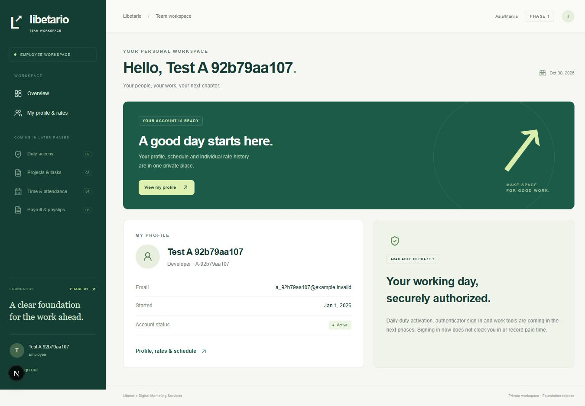
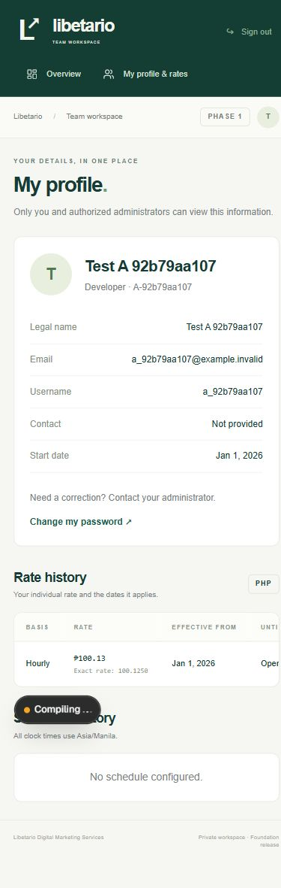

# Phase 1 delivery report

Date: 30 October 2026, Asia/Manila. Status: **Foundation exit test PASSED. Stop before Phase 2 pending owner approval.**

## Delivered

- Working Next.js App Router / TypeScript / Tailwind app with responsive Administrator and Employee dashboard shells, real database totals, explicit empty states, and labeled later-phase features.
- PostgreSQL + Prisma schema and four SQL migrations containing exactly the twelve approved Phase 1 tables. Full-system schema stays in PHASE_1_PLAN.md as design only.
- Restricted runtime role and session-backed RLS, initially proven on profiles/rates at commit `b489623`, then extended to the remaining Phase 1 tables. Employee A/B cannot read each other's profiles, rates, schedules, account rows or protected admin records, including through direct runtime-role SQL.
- Email/username + Argon2id password authentication, persistent account/network lockout, opaque hashed-token sessions, idle/absolute expiry, forced temporary-password changes, logout, and immediate invalidation on disabling/password changes/resets.
- CSRF/origin enforcement, bounded JSON requests, per-request nonce CSP, private/no-store responses, and protected server-only database modules. Migration credentials do not enter request handlers.
- Administrator employee creation/editing/disabling, per-employee effective-dated DAILY/HOURLY rate history, effective-dated seven-day schedules with expected hours/break fields, mandatory edit reasons, concurrency checks, and transactional append-only audit records.
- Employees can view their own rate history. No employee directory or unverified self-service editing.
- Administrator-assisted identity-verified password-reset workflow: one-time private token, hashed storage, configurable expiry, replay/lockout controls, older-token invalidation, and session revocation.
- Versioned security settings, development-only fake seed accounts, `.env.example`, dedicated local PostgreSQL dev/test tooling, setup/user/security/backup/integration notes, and acceptance-test mapping.

No live Libetario client/invoicing database was accessed. No real secrets are tracked. No production deployment occurred.

## Verification results

| Check | Result |
| --- | --- |
| Initial profile/rate checkpoint before extending RLS | 5/5 passed, exit 0 |
| Final unit + PostgreSQL integration + RLS suite | 27/27 passed, exit 0 |
| Real Next.js HTTP-server checks | 4/4 passed, exit 0 |
| Total final automated tests | **31 passed, 0 failed, 0 skipped** |
| Clean migration replay on a newly created disposable database | Passed; twelve application tables, all RLS enabled; disposable database removed |
| TypeScript `tsc --noEmit` | Passed, exit 0 |
| Next.js production build using webpack | Passed, exit 0; all app pages/handlers dynamically rendered |
| Production dependency advisory audit | Exit 0: no known vulnerabilities found |
| Manual browser review | Administrator overview at tablet/mobile widths; employee dashboard/profile/rates at 1365px and 390px; real login and own-record navigation checked |
| Mobile horizontal overflow | A hidden table label was corrected; measured document width 375px within a 390px viewport |
| Secrets / schema boundary | `.env`, `.env.test.local`, `.local/` ignored; runtime source has no migration URL access or sample passwords; only twelve approved application tables exist |

Real HTTP checks prove A→B and B→A guessed profile UUID URLs return 404; employee calls to admin APIs return 403; anonymous reads return 401; own reads succeed; administrator reads succeed. Employee SSR/client payloads contain only the current employee's profile/rate data. Employee access to another employee's administrator page redirects without including the other record. Logout cookie replay fails. CSRF rejection and security headers are checked over the actual server.

Tests use a separate `libetario_test` database and real non-owner/NOBYPASSRLS role connections. They do not replace authorization with mocks. Test fixtures and screenshots show fake identities and test rates, not live workforce data. Browser screenshots were captured during review; a later development-server configuration restart interrupted the preview tab. Automated HTTP tests were repeated successfully after the final code/config changes.

## Run locally

The workspace is already bootstrapped, migrated and seeded. Keep existing ignored environment files; do not rerun bootstrap/seed over existing data.

1. Start `pnpm db:local` in one terminal if the dedicated database is stopped.
2. Run `pnpm dev` in another terminal.
3. Open `http://127.0.0.1:3000`. Fake temporary sample credentials and the bundled-pnpm alias are in README only. Change each sample password on first sign-in.

See [README](../README.md) for fresh-checkout setup and exact test commands. Production requires HTTPS and environment-provided secrets; local development uses HTTP on loopback. The test HTTP server uses port 3001 and the separate test database.

## Known gaps and deliberate phase boundaries

- Phase 1 is account access only. Duty activation, PIN/TOTP, encrypted authenticator enrollment/recovery and duty revocation belong to Phase 2. There is no duty-capable session or working clock-in now.
- Projects/files, timers/attendance, payroll/PDF/payments and their tables/migrations remain Phases 3–5. Their acceptance scenarios are explicitly deferred in TEST_COVERAGE.md. No pay is derived from login or task gaps.
- Work/pay policy JSON is a versioned future-phase reference; only security settings are editable through the current Settings UI. No statutory rates, holiday premiums or a finalized payroll formula were invented.
- Rate and schedule histories support appending a new effective date. Correcting earlier history through a controlled retrospective adjustment workflow is future work; the API rejects overlapping or non-increasing effective dates.
- Password-reset tokens require private administrator delivery; no email/SMS provider is configured. A lost final administrator password requires a documented DBA-assisted recovery process before production; public self-registration/recovery is intentionally absent.
- Hosting is local only because the owner's hosting field was not filled in. There is no staging/production URL, TLS proxy or managed-provider provisioning yet. Backups/restore procedures are documented; a production restore rehearsal and retention schedule await the release phase.
- The supported webpack compiler is used: Turbopack's CSS worker failed on this Windows runtime. Prisma's relation loading currently emits a non-failing pg 8 queued-query deprecation warning; the installed lockfile remains on pg 8 and all data/security tests pass.

## Owner/accountant decisions

Before production: select the hosting/database provider; provide actual employee identifiers, designations, schedules, expected hours, rates/effective dates; approve timeout/lockout values and the identity-verification/private reset-delivery procedure; decide whether to enable PIN and overnight/multiple-shift policies; approve classification, cutoff, rounding, breaks, partial days, holidays, overtime and deduction applicability with the accountant. Also approve retention, backups, recovery ownership and privacy access procedures.

These do not change the passed Phase 1 gate. No later phase has started.

## Browser evidence

Employee desktop dashboard (fake test account):

Employee mobile profile and own rate history (fake test account):

