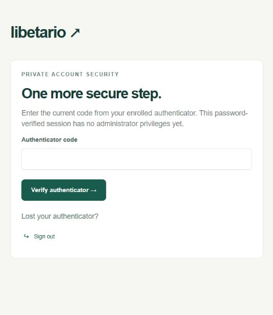
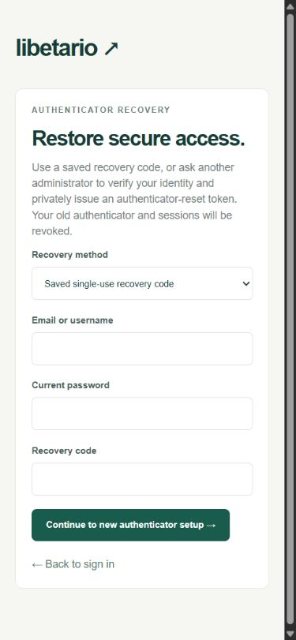

# Phase 2a delivery report

Date: 30 October 2026, Asia/Manila. Status: **Phase 2a security checkpoint PASSED. Stop before 2b pending owner approval.**

## Delivered

- Environment MFA keyring with safe local initialization, AES-256-GCM encryption, user/enrollment/generation-bound associated data, key IDs and an audited transactional rotation script. QR generation stays on the server; plaintext secrets/QRs are never persisted or logged.
- Three new tables only: mfa_enrollments, employee_pins, recovery_codes. Seven additive Phase 2a SQL migrations extend existing sessions/resets/policies and security functions. Eleven migrations in total create **fifteen application tables**. Each new table has RLS, real ownership FKs, constraints/indexes and restricted grants. No duty/task/time/payroll tables exist.
- Mandatory administrator TOTP: password yields five-minute SETUP only. Administrator records, APIs, server pages, DAL and direct runtime-role queries remain unavailable before MFA. Confirmed TOTP rotates to ACCOUNT; previous cookies cannot be replayed. Pre-2a sessions are revoked by migration. This is the approved extension beyond Blueprint Section 5.
- One-time locally encoded QR enrollment confirmed by a first valid RFC 6238 code. SHA1, six digits, 30-second period, ±1-step drift and strictly increasing transactional last_accepted_step. First confirmation consumes its step. Pending enrollments bind to the originating user/session and expire after five minutes.
- Employee six-digit PIN setup/change/forgotten-PIN replacement, Argon2id hashing and independent attempt limits. PIN ships **DISABLED** in versioned SECURITY.pinEnabled. Actual duty enforcement awaits 2b.
- Ten once-only 160-bit recovery-code secrets with salted Argon2id hashes, batch revocation and atomic single-use consumption. Password + unused code revokes the old authenticator, old codes and all sessions, bumps account authorization_version and issues enrollment-only SETUP. Self-service NEW-generation enrollment and confirmation is required before privileges return, with fresh recovery codes.
- Different-administrator assisted authenticator reset with mandatory verification note/reason, recent TOTP, private hashed/single-use 15-minute token, immediate revocation and audit. Password is still required to redeem the token. Password changes/reset invalidate sessions and outstanding reset capabilities without removing MFA.
- Migration-owner-only last-administrator recovery CLI with exact confirmation, note/reason, operator audit and production/remote refusal without explicit flag. It cannot be called by request handlers and leaves password/role/enabled status unchanged. Explicit local second-administrator seeding provides a fresh temporary password and mandatory password change/MFA onboarding.
- Administrator security page with real enrollment states, assisted reset and recent security events; employee own-security/enrollment/PIN/recovery screens. No fake live counters.
- SECURITY policy preserves omitted flags, rejects stale expected IDs, requires recent MFA and cannot disable mandatory administrator/duty TOTP. Policy changes invalidate unfinished SETUP sessions. ACCOUNT defaults remain 15-minute idle/60-minute absolute. The future DUTY expiry utility and configurable defaults are separately tested: 30-minute idle, valid_until cap, maximum twelve hours. No DUTY session can be issued in 2a.

README and ASSUMPTIONS document separate keyring backups, complete-loss re-enrollment, rotation, second-admin provisioning, lockouts, reset flows and the approved 2a/2b split. No live Libetario client/invoicing database was accessed, no production system was contacted, and no real secrets are tracked.

## Verification results

| Check | Result |
| --- | --- |
| Complete unit + real PostgreSQL integration + restricted-role/RLS suite | **46/46 passed**, exit 0 |
| Actual Next.js HTTP-server tests | **9/9 passed**, exit 0 |
| Total final automated tests | **55 passed, 0 failed, 0 skipped** |
| Clean migration replay | Passed; all eleven migrations, fifteen RLS-enabled application tables; only the newly created disposable database removed |
| TypeScript typecheck | Passed, exit 0 |
| Prisma client generation and Next.js webpack production build | Passed, exit 0; app routes dynamically rendered |
| Production dependency advisory audit | Passed, exit 0: no known vulnerabilities found |
| Browser review | Real fake-account password login reaches administrator TOTP gate; recovery form reviewed at mobile 390px, document width 375px with no horizontal overflow |
| Secrets / phase boundary | Environment and local data ignored; runtime source has no migration credentials or operator-script imports; duty_authorizations/auth_challenges absent; no duty-capable session value |

The 19 focused unit/database tests supplement all 27 foundation regressions. They prove RFC vectors/drift, AEAD tampering/user binding/key loss, encrypted enrollment, expiry, concurrent TOTP/recovery use, replay, persisted lockout, PIN hashing, assisted reset expiry/ownership/recent-MFA rules, policy preservation and setup revocation, direct runtime-role denial of MFA secrets/claims/operator functions, actual CLI confirmation/audit, key rotation preserving generations/counters and explicit second-admin creation. The production-flag CLI test uses NODE_ENV=production against the local test database only.

The nine real HTTP tests include the four foundation regressions and five MFA checks. They prove administrator password-only app/SSR denial, real TOTP confirmation/cookie rotation, consumed-code replay rejection, next-request denial after disabling, recovery revocation and NEW-factor confirmation before admin access, cross-user enrollment tampering denial, assisted reset, lockout across replacement setup cookies, expired setup denial, CSRF and absent duty/operator endpoints. A separate privileged fixture creates test rows; the requests run through the real local server and restricted database roles.

See TEST_COVERAGE.md for exact Section 15 status. Scenario 2's 2a components pass; the complete scenario awaits actual duty authentication in 2b. Scenarios 1 and 3 are not claimed passed. Browser review did not enroll a real device or expose QR/recovery secrets; enrollment/confirmation are exercised by automated HTTP tests.

## Run locally

This workspace is migrated and has ignored local keyrings. Preserve .env, .env.test.local and .local data. Do not rerun bootstrap/default seed over existing data.

1. Start `pnpm db:local` in one terminal if the dedicated database is stopped.
2. Start `pnpm dev` in another terminal and open `http://127.0.0.1:3000`.
3. Sign in, change any temporary password, sign in again and enroll/confirm administrator TOTP. Save recovery codes privately. Fake seed credentials and the bundled-pnpm alias are in README only.

For a fresh checkout or Phase 1 upgrade, follow README, including `pnpm mfa:init-keys`, migrations/client generation and separately migrating the dedicated test database. Run `pnpm test`, `pnpm db:replay-check`, `pnpm typecheck`, `pnpm build`; run `pnpm test:http` against the separate test server on port 3001. Run database and HTTP suites sequentially because the rotation test temporarily selects a test key and restores it. Operator/second-admin commands and key backup/rotation procedures are fully documented in README. Local verification servers are stopped after delivery; their data/configuration are retained.

## Known gaps and deliberate checkpoint boundaries

- **2b is not started:** duty_authorizations, auth_challenges, duty login/session reauthentication, authorization_version duty revocation, activate/revoke/bulk controls, duty screens and real overnight session tests remain gated. The approved future same-grant flow is TOTP plus PIN when enabled, with no repeat password. Its real HTTP proof belongs to 2b. The twelve-hour limit is per duty session, not a clock-out/pay cutoff.
- Overnight remains disabled; the approved eight-hour carry ceiling and grant-date/session behavior will be implemented/tested in 2b. Actual shifts/timers and retention of recorded paid/work intervals remain Phase 4. Authentication creates no paid time.
- No Phase 3 projects/tasks/uploads, Phase 4 attendance or Phase 5 payroll/PDF features/tables were introduced. Accountant-controlled policies/deductions remain configurable future work; no statutory rates were invented.
- Reset-token delivery is private/manual; no email/SMS provider is configured. Lost/expired recovery SETUP requires assisted reset because the old factor/codes stay revoked. Last-admin CLI handles MFA loss only; lost final-admin password still needs a separately approved owner/DBA password-recovery procedure.
- Keyring backup custody, production backup/restore rehearsal, hosting/TLS and retention are owner/release work. Complete keyring loss forces re-enrollment. Cryptographic and rotation tests plus migration replay do not replace a production restore drill.
- Hosting remains local only. Build success does not authorize production deployment or real payroll use. A real-phone authenticator onboarding walkthrough remains part of owner acceptance.
- Supported webpack build is retained for this Windows environment. Prisma/pg emits the same non-failing queued-query deprecation warning observed in Phase 1; all checks pass with the locked pg 8 dependency.

## Owner/accountant decisions

No new policy choice blocks this accepted 2a implementation. Before real use, designate a second administrator, reset-verification/private-delivery operators, separate encrypted keyring backup custody and recovery ownership. Approve a final-admin lost-password procedure independently from MFA recovery. Retain PIN disabled unless explicitly enabled; 2b will add its duty enforcement. Hosting remains local until separately selected. The previously documented pay/schedule/cutoff/holiday/overtime/deduction decisions remain later owner/accountant work.

**Approval requested only for checkpoint 2b. No 2b or Phase 3 implementation has started.**

## Browser evidence

Administrator MFA gate after a real fake-account password sign-in; no OTP or QR is shown:

Mobile recovery form with empty inputs:

