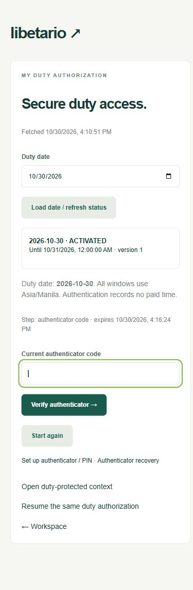

# Phase 2b delivery report

Date: 30 October 2026, Asia/Manila. Status: **Duty-security checkpoint PASSED. Stop before Phase 3 pending owner approval.**

## Delivered

- Exactly two new application tables, duty_authorizations and auth_challenges, with RLS, real ownership FKs, indexes and constraints. Four additive 2b SQL migrations bring the total to **fifteen migrations / seventeen application tables**. The full system schema remains a later-phase design reference.
- Function-based administrator activation, revoke, explicit regrant and atomic bulk activation of up to 100 selected active employees. Reasons are mandatory. Identical active snapshots are no-ops, including an existing overnight snapshot after WORK policy is disabled; revoked grants cannot be silently resurrected. Disabled employees' grants can still be revoked.
- Revocation/regrant increment the duty authorization_version, revoke bound DUTY sessions/challenges and write prior/current grant metadata and security events in one transaction. No historical rows are deleted. Original first-authentication metadata is retained in audit when continuation eligibility is reset.
- Staged duty login: ACCOUNT binding + fresh password -> optional PIN under current SECURITY policy -> current TOTP -> a DUTY session linked to the exact employee, grant, duty date and version. PIN success rotates challenge/CSRF without extending its original five-minute deadline. All factors use the existing persistent lockout infrastructure and global TOTP replay counter.
- Separate ACCOUNT and DUTY cookies. Initial duty completion rotates ACCOUNT and issues DUTY. The shared requireDuty() DAL guard and private.duty_context() enforce every protected request/query; ACCOUNT and SETUP cannot satisfy them. Real `/api/duty/context` and `/duty/context` use this guard. Invalid page access redirects to reauthentication; no clock-in, timer, attendance or paid time exists.
- Same-grant reauthentication with current TOTP plus PIN when enabled, without repeating password or minting an ACCOUNT session. DUTY defaults to 30-minute idle and min(valid_until, issuance + maximum twelve hours) absolute lifetime. Server session expiry is independent of cookie retention: the opaque handle is kept until valid_until only to bind a new MFA challenge, never to extend access by itself.
- SECURITY switches serialize against final issuance and invalidate incomplete challenges and existing DUTY access. New same-grant reauthentication proves current policy/factors; invalidated proofs remain unusable. PIN changes, account disabling/resets, enrollment changes and employment changes invalidate affected credentials. Logout and duty revoke/regrant cannot revive old handles.
- Overnight remains disabled by default. Explicit authorized windows are bounded by WORK.overnightCarryHours (default eight, configurable 1–8). A grant first authenticated on its authorized Manila date keeps that date/version across midnight and later MFA reauthentication. Non-overnight access ends at midnight; no next-date activation or new backdated regrant start is implicit. WORK changes preserve approved grant snapshots.
- Administrator duty dashboard with date selection, actual authorization list, activate/revoke/regrant/bulk actions, current-policy overnight settings and a date/event/employee-filtered redacted security log. Employee own-status/date selection and staged sign-in/reauthentication screens show actual records and fetch time. Refresh is explicit. No generated TOTP is displayed beside its input.
- UTC connection settings fix the PostgreSQL/Prisma adapter's local-timezone timestamp conversion exposed by HTTP clock tests. UTC instants, twelve-hour caps and Asia/Manila presentation now reconcile in real responses. Trusted time overrides are test-owner fixtures only, never a request header/parameter or production environment setting.

The accepted 2a encrypted keyring, mandatory administrator MFA, recovery/reset, operator recovery and backup/rotation procedures remain intact. No existing live Libetario client/invoicing database was accessed, no real secrets are tracked, and no production deployment occurred.

## Verification results

| Check | Result |
| --- | --- |
| Complete unit + real PostgreSQL integration + restricted-role/RLS suite | **54/54 passed**, exit 0 |
| Actual Next.js HTTP-server suite | **19/19 passed**, exit 0 |
| Total automated tests | **73 passed, 0 failed, 0 skipped**; all 55 prior checks retained, 18 new duty checks |
| Clean migration replay | Passed, exit 0; all fifteen migrations, exactly seventeen RLS-enabled application tables; only the newly created disposable database removed |
| TypeScript typecheck | Passed, exit 0 |
| Prisma generation / webpack production build | Passed, exit 0; app routes dynamically rendered |
| Production dependency advisory audit | Passed, exit 0: no known vulnerabilities found |
| Actual-server page checks | Own employee duty page, duty-protected page and administrator duty dashboard render through real guards; ACCOUNT-only protected-page requests redirect |
| Browser review | Fake employee account -> real duty status -> password -> empty TOTP step, at mobile 390px; document width 375px, no horizontal overflow |
| Secrets / boundary | Environment/local files ignored; no runtime migration credentials, operator imports or test-clock imports; no Phase 3+ tables, uploads, shifts or payroll |

Scenario 1's Phase 2 portion passes: A activated/B absent, secure duty login, exact guard access and ACCOUNT denial. Scenario 2 passes in full for this security phase, combining all accepted MFA/recovery/reset regressions with PIN-off/on/missing, stage ordering/rotation, foreign/expired/replayed challenges, cross-purpose/concurrent TOTP replay, account/challenge/network locks and safe expiry. Recovery and assisted authenticator reset during active DUTY revoke access/challenges; a replacement authenticator's ACCOUNT session does not itself grant duty, and old tokens remain invalid after new enrollment/sign-in.

Scenario 3's Phase 2 portion passes: the next HTTP request and direct runtime guard fail after a committed revoke. Deterministic race tests hold PostgreSQL row locks, observe blocked real requests and release in both orders: revoke-first prevents issuance; issuance-first yields a cookie that is unusable after revoke commits. Regrant does not revive old tokens. Existing session/rate/enrollment rows remain, with prior grant metadata audited.

The overnight/15.12 access portion passes over real HTTP with owner-controlled server time: before/after Manila midnight, non-overnight denial, original overnight date/grant/version retained, ordinary expiry, TOTP-only and PIN+TOTP reauthentication, twelve-hour cap, explicit valid_until denial, default-off/eight-hour ceiling and no implicit next-date activation. Actual paid/work-time preservation, missing punches and protected uploads remain later phases. TEST_COVERAGE.md maps every Section 15 scenario honestly; targeted reruns are not extra tests.

## Run locally

The local dev/test databases are migrated. Preserve ignored .env, .env.test.local and .local files and the existing keyring. Do not rerun bootstrap/default seed over existing data. Local verification services are stopped after delivery; all data/configuration are retained.

1. Start `pnpm db:local` in one terminal.
2. Run `pnpm dev` in another, then open `http://127.0.0.1:3000`.
3. Administrator signs in with mandatory TOTP, opens Duty access, selects a date, provides a reason and activates selected employees. Keep overnight and PIN off unless explicitly configured.
4. Employee enrolls/confirms an authenticator in Account security, then opens Duty access and completes password -> optional PIN -> TOTP. The protected context demonstrates authorized access and records no time.

For a fresh checkout, follow README. For an accepted 2a checkout, preserve keys/data and run `pnpm db:migrate` and `pnpm db:generate`; migrate the separate test database as documented. No new secrets are required for 2b. Run `pnpm test`, then `pnpm test:http` against the dedicated test server, followed by replay/typecheck/build/audit commands in README. Clock/rotation tests run sequentially with HTTP tests and restore test-only state in finally.

## Known gaps and deliberate phase boundaries

- No Phase 3 work has started: projects, shared tasks and protected uploads are absent. Clock-in, timers, attendance, actual overnight shift/time preservation and missed-punch workflows are Phase 4. Payroll/PDF/payment workflows and accountant rules remain Phase 5. Authentication never creates paid time.
- The duty context is a real authorization proof, not an attendance/task screen. COMPLETED remains a reserved database state; no duty-completion/clock-out action is exposed now.
- A retained duty handle supports same-grant MFA under current policy while its grant/version/window remains valid. Clearing the cookie, logging out, duty revoke/regrant, account reset or employment invalidation prevents old-handle continuation. New backdated starts are denied; an administrator must review the appropriate authorization when credentials/handles are lost after midnight. No existing time is erased by that security boundary.
- Browser evidence uses fake test identities and authorization data. Employee mobile staging was reviewed visually; administrator dashboard/API and protected pages have automated actual-server checks. A real-phone, full owner workflow walkthrough and broader browser/release regression remain acceptance/release work.
- Hosting stays local only. Production TLS/provider choice, backup custody/restore rehearsal, retention and a final-administrator lost-password procedure remain owner/release decisions. Keyring backup must remain separate from database backup; complete key loss still forces re-enrollment.
- Supported webpack build remains in use on this Windows runtime. The existing non-failing Prisma/pg queued-query deprecation warning remains; all tests pass with the locked dependency. No new production package dependency was added for 2b.

## Owner/accountant decisions

No open payroll policy was invented. Current approved defaults remain PIN off, overnight off, eight-hour maximum carry when explicitly enabled, 30-minute duty idle, maximum twelve-hour absolute and local-only hosting. Before real use, designate duty administrators, second-admin/recovery ownership, private identity verification/delivery procedures and separate keyring backup custody. Decide whether and for whom to enable PIN/overnight policy. Schedules, wage/cutoff/holiday/overtime/deduction decisions remain later owner/accountant work.

**Checkpoint 2b is complete. Stop here; Phase 3 requires separate owner approval.**

## Browser evidence

Fake employee's real activated duty record and staged sign-in, with no OTP entered or generated beside the field:

