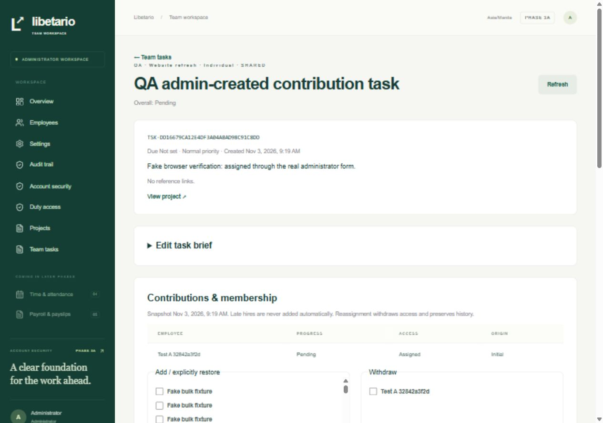
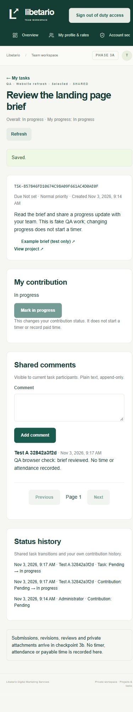

# Phase 3a delivery report

Date: 3 November 2026, Asia/Manila. Status: **Projects/shared-task checkpoint PASSED. Stop before checkpoint 3b pending owner approval. Phase 4 has not started.**

## Delivered

- Exactly four new application tables: projects, tasks, task_assignments and task_comments. Real foreign keys, unique retry/membership keys, checked shapes/statuses, deferred assignment cardinality, supporting indexes, RLS and restricted grants. Seven additive 3a migrations bring the total to **22 migrations / 21 application tables**. No submission, review, upload, notification or time/payroll table was migrated.
- Real project creation/editing/status controls, standalone client label/website/description/references, start/deadline/priority fields, administrator project/task screens and actual scoped counts. Projects default **ACTIVE**; PLANNING remains selectable. Non-ACTIVE employee task pages explain why progress and comments are read-only, and both server and database reject those writes.
- **SHARED only**, with INDIVIDUAL, SELECTED and ALL_ACTIVE audiences. Each recipient has a durable separate assignment/contribution identity and own progress/history. A shared task counts once in project totals; cancelled tasks are separate, and empty work is not shown as 100% complete. COPIES/COPY_SOURCE, their columns/triggers and copy tests are deferred by the owner's amendment to Blueprint Section 6.
- ALL_ACTIVE materializes an explicit eligibility snapshot: enabled EMPLOYEE, ACTIVE employment and start date reached in Manila. Later hires/reactivations/duty activations are never silently added. Creation retries preserve the first committed snapshot; concurrent hires cannot expand a captured snapshot while creation waits. Invalid recipients/capacity roll back the entire operation. Default cap **500**, configurable through versioned WORK.tasks.maxRecipients with recent administrator MFA, expected policy ID and reason. The recipient picker does not silently truncate the eligible directory.
- Versioned, reasoned membership addition/withdrawal/reassignment/restoration. Withdrawal removes next-request access, preserves the contribution row and audits cancellation/exclusion of unfinished work. An INDIVIDUAL replacement is atomic. Withdrawing every recipient cancels the task; an explicit reasoned recipient restoration on an ACTIVE project reopens Pending and retains original contribution IDs/history. Lowering capacity does not delete historical assignments.
- Employee work data requires the shared **requireDuty** guard plus live database predicates for every resource. ACCOUNT keeps profile/rates/duty status and established security maintenance. Work pages have a separate duty-aware layout, so valid DUTY does not depend on ACCOUNT remaining alive. Administrators use fully MFA-verified ACCOUNT without duty. Conflicting active cookie identities are rejected; privileges are never merged.
- A/B isolation covers tasks, contribution rows, comments and project task counts, including separate tasks inside the same project. Minimal comment author labels and a narrow task/own-contribution history projection grant no broad profile, rate, directory or audit-log access under DUTY. Foreign/missing UUIDs have the same 404 response for an otherwise valid work actor.
- Pending -> In progress for the actual employee's own contribution; administrator reasoned cancel/restore; derived overall task progress; actor/server timestamp and append-only audit in the same transaction. Service and database reject SUBMITTED, REVISION_REQUIRED and APPROVED/Completed until 3b supplies real submission/review records. Project COMPLETED is similarly unavailable now. No fabricated review/approval shortcut exists.
- Plain-text append-only shared comments, bounded HTTP(S) references without automatic fetching, real search/filter/pagination/refresh, CSRF/origin checks, 128 KiB request bound, optimistic conflicts and retry keys. New/Updated list indicators compare real task/project/contribution versions with private per-assignment list-visit markers. Only observed versions are acknowledged; a concurrent update stays unread. **Notifications remain out of scope for 3a and 3b.**
- Database lock ordering and authorization rechecks protect against duty revocation, withdrawal, disabled accounts, policy changes and expiry while waiting. The original overnight grant/date is retained by task access; no implicit next-date duty is created. Authentication, broadcasts, comments and progress create **no paid time**.

The approved 3b design is updated for synchronous authenticated-request upload validation: no file processor role, background worker, lease/claim/retry columns or malware-scanner adapter. No 3b code/storage was built. Private ownership, quarantine/available/rejected states, validation/size/resource limits, quotas, exclusive keys, streaming authorization and all tampering tests remain the next checkpoint's requirements. A worker can be considered later if volume grows.

No live client/invoicing database was accessed, no real secrets were tracked and no production deployment occurred.

## Verification results

| Check                                                               | Result                                                                                                                                                          |
| ------------------------------------------------------------------- | --------------------------------------------------------------------------------------------------------------------------------------------------------------- |
| Full unit + real PostgreSQL integration + restricted-role/RLS suite | **75/75 passed**, exit 0                                                                                                                                        |
| Actual Next.js HTTP-server suite                                    | **31/31 passed**, exit 0                                                                                                                                        |
| Total automated tests                                               | **106 passed, 0 failed, 0 skipped**: all 73 prior checks plus 33 new 3a checks                                                                                  |
| New test inventory                                                  | 19 PostgreSQL integration + 2 unit + 12 actual HTTP checks; reruns are not extra tests                                                                          |
| Clean migration replay                                              | Passed, exit 0; all **22 migrations**, exactly **21 RLS-enabled application tables**; only a newly created disposable database removed                          |
| Separate TypeScript check                                           | Passed, exit 0                                                                                                                                                  |
| Prisma generation / webpack production build                        | Passed, exit 0; protected app routes rendered dynamically                                                                                                       |
| Production dependency advisory audit                                | Passed, exit 0: no known vulnerabilities found                                                                                                                  |
| Grant / phase boundary                                              | Four new tables: runtime SELECT only with RLS; mutations through scoped functions; auth role denied. Non-owner/NOBYPASS roles retained; no file processor role  |
| Secret / operator boundary                                          | Only .env.example tracked; no migration credentials, QA/operator imports or test-clock imports in request code                                                  |
| Actual browser                                                      | Employee password/TOTP duty login -> list/detail -> progress/comment save; MFA administrator -> real assignment form -> saved task/contribution                 |
| Responsive review                                                   | Employee 390px viewport / 375px document, administrator 1280px / 1265px; no document horizontal overflow. Wide tables/navigation scroll within their containers |

Blueprint 15.4's **3a data/collaboration/counting portion passes**: three duty-authenticated assignees see one task, have three separate own contribution identities and independent progress, share authorized comments and count one project item. Reviewed completion/submissions are 3b; actual distinct timers/durations remain Phase 4. Scenario 4 is not marked wholly complete.

Regression retains Scenarios 1–3's accepted security portions and the full Phase 2 failure/recovery/reset/lockout matrix. New checks prove ACCOUNT/SETUP denial, same-project ID guessing through HTTP/SSR/RSC and direct runtime SQL, scoped search/counts (including beyond the final page), role/actor protection, invalid status transitions, immutable comments, retries, body/origin/CSRF limits and private per-user indicators. PLANNING/ON_HOLD/CANCELLED read-only messages/writes have actual HTTP evidence; COMPLETED is DB-blocked in 3a and its future read-only message has unit coverage.

Deterministic races observe actual blocked PostgreSQL requests: captured ALL_ACTIVE recipients versus a concurrent hire, revoke-first versus progress, withdrawal versus comment insertion, and administrator session expiry while task insertion waits. Final writes deny stale authorization. Existing Phase 2 issuance-first/revoke-first races still pass. Revocation/withdrawal retains legitimate comments, contribution identities and audit history. Task access across Manila midnight keeps the original authorized date/window; end-of-window access fails. Only migration-owner fixtures in the dedicated test database replace the trusted server clock, and they restore it in finally.

TEST_COVERAGE.md maps all Section 15 scenarios and deferred portions. No upload test or positive reviewed-completion test is claimed passed before 3b. Money/time/timezone/cutoff unit regressions remain green; no attendance or wage calculation was added.

## Run locally

The local development and test databases are migrated. Preserve ignored .env, .env.test.local, .local files and the existing MFA keyring. Do not rerun bootstrap/default seed over existing data. Verification services are stopped after delivery; data/configuration are retained.

1. Start `pnpm db:local` in one terminal.
2. Start `pnpm dev` in another and open `http://127.0.0.1:3000`.
3. Administrator signs in with mandatory MFA, opens Projects, creates an ACTIVE project and assigns a shared task. Choose an explicit audience or ALL_ACTIVE snapshot. Open task detail for membership, cancellation/restoration, status history and comments.
4. Employee enrolls/confirms MFA if needed, receives dated duty authorization, completes secure duty sign-in and opens **My tasks** or `/work/tasks`. Mark only their own contribution In progress and comment. An ACCOUNT-only visit redirects to duty reauthentication and cannot read work data through the API/SQL.

For a fresh checkout use README. For accepted 2b, run `pnpm db:migrate` and `pnpm db:generate` with the preserved local configuration; migrate the separate test database as documented. No new 3a secret or dependency is required. Tests use `pnpm test`, then `pnpm test:http` against the test server, followed by replay/typecheck/build/audit commands in README. Keep clock/rotation suites sequential. The optional qa-work-fixture script creates clearly fake data only in the dedicated test database and is never imported by the app.

## Known gaps and deliberate phase boundaries

- **3b has not started.** Submissions, reviews, revisions, protected files/uploads/downloads and their tampering tests are absent. Six later tables will bring the approved target to 27. Submission/review-only states are intentionally rejected in 3a.
- **COPIES and notifications are deferred by owner decision.** The only collaboration mode accepted by CHECK is SHARED. The employee list indicator is implemented; there is no inbox, email, notification table, push service or background notification job.
- Positive all-required-contributors approval/project completion needs real 3b reviews. Current tests prove one task denominator, distinct progress, cancellation/empty behavior and denied premature approval; they do not invent approved data to claim the later workflow works.
- Clock-in, timers, attendance, actual overnight time preservation, corrections and payable accounting remain Phase 4. Payroll, PDF payslips and payment workflows remain Phase 5. No task action starts a timer or creates wages.
- Browser evidence covers local desktop/mobile viewport flows with fake records. A real-phone, broader browser/accessibility release pass, owner walkthrough, production backup/restore rehearsal and hosting/TLS decisions remain release work. Clean migration replay is not a production restore rehearsal.
- Hosting remains local only. The supported webpack build remains in use. The pre-existing non-failing Prisma/pg queued-query deprecation warning remains; no new package dependency was introduced.

## Owner/accountant decisions

No new policy decision blocks this checkpoint. The approved defaults are ACTIVE projects, SHARED collaboration, own-contribution privacy, all-required-contributors completion once reviews exist, explicit ALL_ACTIVE snapshots, maximum/default 500 recipients, PIN/overnight off and local-only hosting. Decide actual project briefs, recipients and administrators during the walkthrough; the cap may be lowered through versioned settings.

Before real deployment, confirm retention/backup custody, separate MFA-keyring backup and recovery ownership. Payroll classification, rates, cutoff/rounding/break/holiday/overtime/deduction choices remain later owner/accountant work; none was invented here.

**Checkpoint 3a is complete. Stop here and wait for owner approval before 3b. Do not start Phase 4.**

## Browser evidence

All records below are clearly fake test-database records. No password, QR, secret, OTP, bearer token or recovery code appears in these images.

Administrator created this task through the actual assignment form:

Employee mobile detail after actual duty login, progress change and comment save:

