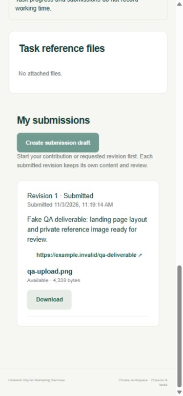
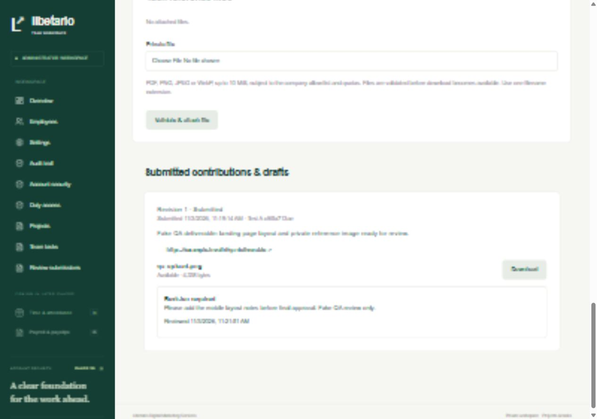

# Phase 3b delivery report

Date: 3 November 2026, Asia/Manila. Status: **Protected deliverables checkpoint PASSED. Stop here for owner acceptance. Phase 4 has not started.**

## Delivered

- Exactly six new application tables: task_submissions, task_reviews, file_objects, project_files, task_files and submission_files. The schema now has **27 application tables / 33 additive migrations**. Actual actor/owner/session/project foreign keys, unique revision/review/retry constraints, one-DRAFT-per-assignment partial index, state/size constraints and supporting indexes are enforced in PostgreSQL. task_assignments.current_submission_id has the planned composite FK to the same assignment. No notification, timer, attendance or payroll table was added.
- RLS covers every new table. Employees require the shared requireDuty guard and can read only their own assignment's submissions, reviews and submission files, including within a shared task. Common project files require a current project-task assignment; task files require the exact task. MFA administrators use ACCOUNT without duty. Ordinary ACCOUNT/SETUP cannot read work data. Restricted runtime has scoped SELECT/column grants and narrow function mutations; auth role has no new-table access. Runtime cannot directly change file state/owner, replace the validator verifier or mint AVAILABLE objects without the server-held validation proof.
- Actual employee draft creation, notes/URL editing, abandonment, file exclusion and submission. Submit saves and freezes notes, URLs and all included AVAILABLE links in **one transaction**, with optimistic versions and current duty/membership checks. Failed/quarantined links must be excluded or resolved before submitting. Exclusion retains the permanent typed owner and history; it does not free quota. No URL is fetched automatically.
- Immutable submitted/abandoned revisions and administrator decisions. Administrators review only the current submitted revision: APPROVED or REVISION_REQUIRED with a **10–2,000 character reason**. Resubmission creates a new increasing revision; old content/decisions cannot change. Stale/concurrent requests cannot overwrite decisions or freeze stale content. Review reasons remain private to the affected contribution, never shared task history.
- Submission/review-only states are now enabled through real service/database workflows, with required proof records and timestamped actors/audit. Employees can start a requested revision or draft/resubmit directly from REVISION_REQUIRED. A shared task becomes APPROVED only with at least one required contribution and every required contribution approved. Each shared task counts once. Project COMPLETED requires non-empty countable work, all approved. APPROVED is terminal; follow-up work uses a new task. Withdrawing approved access retains its counted approved contribution and immutable decision; restoring access cannot reopen it.
- Real administrator review queue and task review form; employee private draft/submit/revision history; private reference/attachment lists, exclusions and downloads; administrator versioned WORK.uploads form with recent MFA, expected policy ID and reason. Non-ACTIVE projects remain explicitly read-only. All displayed records/counts come from the database. COPIES and notifications remain deferred by owner decision.
- Synchronous private uploads of PDF, PNG, JPEG and WebP, with the allowed-type list and supported limits in validated **WORK.uploads**. Default maximum **10 MiB/file**, 10 included files/draft, 100 MiB/uploader/Manila day, 1 GiB/project and 5 GiB/application. Reservations include quarantined/rejected bytes until physical removal is recorded. Persistent per-user attempts default to 20 uploads and 120 downloads per 15 minutes.
- One raw-binary file per authenticated/CSRF-protected upload request. Actual bytes, declared size, MIME, matching single extension, signature and complete bounded structural parse/decode must agree. Unsafe POSIX/Windows/UNC/NTFS/control/reserved/double-extension names are rejected. Display names never determine storage paths. Images fully decode within 8,192 pixels/axis and 20 MP; PDFs are parsed within 500 pages and object/depth/decoded-stream limits. Ordinary text and JPEG-image PDFs are supported; active/encrypted/unsupported or malformed content is rejected. This is not a malware-free claim.
- At most **two** synchronous validations across app processes, using session advisory locks, with a **30-second** deadline. A short-lived parser child is awaited by the request, with no DB/key environment and bounded heap/decoder allocations. PDF decoder allocation is bounded before inflation, including object streams: 20 MiB decoded-stream limit and 64 MiB cumulative decoder-allocation budget. There is **no processor role, background worker, queue, lease/retry state or malware-scanner adapter**. A worker remains a future volume decision.
- Environment-configured private disk root outside public/static paths; exclusive random 256-bit keys; same-volume exclusive promotion; root/ancestor/junction/symlink/hard-link checks. QUARANTINED becomes AVAILABLE only after validation, private move and transactional live-scope publication. The independent UPLOAD_VALIDATION_KEY stays in environment configuration; only a SHA-256 verifier is stored in company_settings. WORK policy/verifier changes permanently reject pending files. Failed moves/publication remain inaccessible for manual reconciliation.
- Authorized streaming downloads only, with current scope/RLS, full size/hash verification before headers, attachment disposition, nosniff and private no-store. No public URL/key, preview, HEAD or range download. Every 64 KiB chunk rechecks authorization, including a captured membership stamp: withdrawal/restoration cannot revive an open stream. Already-delivered bytes cannot be recalled. Missing/foreign IDs return indistinguishable 404 to a valid work actor.
- Manual migration-owner cleanup for failed/incomplete bytes older than 24 hours, maximum 100/invocation, with optional exact file ID. It confines known paths, reconciles a recognized interrupted hard-link promotion, retains metadata/links/audit and never deletes AVAILABLE content. README covers consistent private-byte/database backups, separate MFA-keyring backup, upload capability binding/rotation and exact Windows test commands.

No live Libetario client/invoicing database was accessed, no real secret was committed and no production deployment occurred. Authentication, broadcasts, uploads, comments, progress, submissions and reviews create **no paid time**.

## Verification results

| Check                                                               | Result                                                                                                                                                                                                                                     |
| ------------------------------------------------------------------- | ------------------------------------------------------------------------------------------------------------------------------------------------------------------------------------------------------------------------------------------ |
| Full unit + real PostgreSQL integration + restricted-role/RLS suite | **96/96 passed**, exit 0                                                                                                                                                                                                                   |
| Actual Next HTTP-server suite                                       | **47/47 passed**, exit 0                                                                                                                                                                                                                   |
| Total automated tests                                               | **143 passed, 0 failed, 0 skipped**; all **106 accepted tests** retained, plus **37** new 3b tests                                                                                                                                         |
| New inventory                                                       | 8 submission + 11 upload database tests, 2 unit tests, 16 real HTTP tests; repeated runs/cases are not extra tests                                                                                                                         |
| Clean migration replay                                              | Passed, exit 0: all **33 migrations**, exactly **27 RLS-enabled application tables**; only its freshly created disposable database removed                                                                                                 |
| Separate TypeScript check                                           | Passed, exit 0                                                                                                                                                                                                                             |
| Prisma generation / production webpack build                        | Passed, exit 0; protected routes server-render dynamically                                                                                                                                                                                 |
| Production dependency advisory audit                                | Passed, exit 0: no known vulnerabilities found at execution time                                                                                                                                                                           |
| Grants / operator / secret boundary                                 | Six new tables have RLS, no direct runtime business mutations, no auth access, protected verifier/storage-key columns, no processor role; only .env.example tracked; operator/QA/test-clock modules absent from request imports            |
| Actual browser                                                      | Real employee password/TOTP duty login, mobile draft save/submit with frozen notes/URL/AVAILABLE attachment; MFA administrator review queue -> task -> recorded revision request; authorized browser download matched the original SHA-256 |
| Responsive review                                                   | Employee viewport 390px / document 375px; administrator viewport 1280px / document 1265px; no document overflow                                                                                                                            |
| Restored local service                                              | Normal development server restored at **http://127.0.0.1:3000**, login HTTP 200; dedicated test server stopped; pre-existing local PostgreSQL left running                                                                                 |

The 3b matrix includes independent private three-person contributions/reviews and one task/project denominator; current-only review, mandatory reasons, immutable snapshots/links, concurrent review/submit/edit, cancellation/withdrawal/terminal states and direct-runtime privacy/ownership denial. The accepted 3a shortcut-rejection tests still pass: statuses cannot be fabricated without real submission/review proofs.

Real paused requests cover withdrawal/restoration, duty revoke and WORK switch during upload; blocked submit versus committed withdrawal or revoke; blocked review versus withdrawal; stale old review racing resubmission; and revocation/withdrawal during an 8 MiB stream. Final checks deny stale access and preserve history. Quarantined attachment submission also rolls back the draft content edits. Lock tests observe actual PostgreSQL waits before committing the competing operation; trusted-clock fixtures are restricted to the dedicated test owner and restored in finally.

Positive fixtures cover all four formats and exact 10 MiB PDF content. Negative cases cover wrong MIME/type, spoofed/double extensions, truncated/malformed PNG/JPEG/WebP/PDF, active PDFs, excessive compressed streams, appended content, oversized/empty/false-length bodies, dimension/pixel/page/time limits, traversal/UNC/alternate-stream/reserved/control names, collisions/junctions, ownership relinking, guessed IDs, HEAD/range/conditional requests, persistent attempts, all quota layers, two in-flight validations, corrupt stored bytes and failed-byte cleanup. TEST_COVERAGE.md maps the individual files and all Section 15 scenarios without claiming later time/payroll acceptance.

Blueprint **15.4's Phase 3 data/collaboration/review/counting portion passes**. Distinct timers/durations remain Phase 4; the entire scenario is not marked complete. Scenario 15.6's submission/revision portion and 15.12's private-upload portion pass; timed rework, punches/overnight time rollover/missing punches remain later. Scenarios 1–3 and the complete accepted MFA/recovery/lockout matrix stay green.

## Run locally

The local development and test databases have the 33 migrations and separate upload capability/root configuration. Preserve ignored .env, .env.test.local, .local, existing private bytes and the MFA keyring. Do not rerun bootstrap/default seed over accepted data.

1. The normal development server is restored at **http://127.0.0.1:3000** and the existing PostgreSQL cluster remains running. On a later restart, run pnpm db:local only if that cluster is stopped, then pnpm dev in a second terminal.
2. Employee receives a dated grant and completes secure duty login, opens My tasks, starts their contribution, creates a draft, saves notes/URLs and validates attachments. Submit for review freezes included content. A revision request permits a new draft/revision; the old one remains readable and immutable.
3. MFA administrator opens Review submissions or task detail. Review the latest submitted contribution with APPROVED or a reasoned REVISION_REQUIRED. All required approvals are necessary before the shared task approves; non-empty all-approved work is necessary before marking the project COMPLETED.
4. To upgrade a separate accepted 3a checkout: preserve data/keys, run pnpm install, pnpm db:migrate and pnpm db:generate; migrate its dedicated test database; run pnpm uploads:init-keys; restart Next. The initializer requires migration-owner/local credentials and never prints keys. README has fresh-checkout instructions and exact PowerShell commands.
5. Run pnpm test and then pnpm test:http sequentially, followed by replay/typecheck/build/audit. **One Next server per folder**, even on different ports. Stop normal development before starting the explicitly configured test server at 3001, and stop it before building or restarting development. Never point test-server uploads at the development database/root.

Defaults and supported bounds are documented in ASSUMPTIONS.md. WORK.uploads is changed only by a recent-MFA administrator with expected policy ID/reason. Manual cleanup uses pnpm uploads:cleanup, or --test for failed test bytes. Consistent backup requires pausing writers/cleanup and retaining both the database and complete private root from the same restore point; back up the MFA keyring separately.

## Known gaps and deliberate phase boundaries

- **Phase 4 has not started.** No clock-in, timer, time segment, attendance, paid-time total, time correction, payroll, payslip or payment implementation exists.
- **COPIES and notifications remain deferred.** SHARED is the only allowed collaboration mode; the real New/Updated list indicator remains. No notification table, inbox, transport or background notification job exists.
- Hosting remains local only. OS account/ACL provisioning, disk-capacity monitoring, production packaging/HTTPS, retention custody, backup/restore rehearsal and broader real-phone/browser/accessibility release acceptance remain release work. Clean replay is not a restore rehearsal.
- Browser file-picker selection could not be verified through the desktop automation bridge: it returned no selected file. Automatic approval review then rejected a screenshot of the native ChatGPT window because it could expose unrelated private content. No native workaround was used. The fake image was instead attached through the real authenticated HTTP endpoint; browser submit, administrator review and an exact-byte authorized browser download were verified. Mobile file-picker selection and its visual error states remain a manual walkthrough item; real HTTP upload/tampering coverage passed.
- Validation intentionally rejects unsupported PDF codecs, active/encrypted documents and animation. It is not a malware scanner. Adding a new type/parser requires reviewed code plus an MFA administrator's allow-list update. The pinned PDF decoder's allocation guard must be reviewed/retested on dependency upgrades. Successful objects have no automatic expiry/deletion; operator cleanup concerns only old failed bytes.
- The accepted non-failing Prisma/pg queued-query deprecation warning remains. It does not change the test exit status. No production dependency advisory was reported at this verification point.

## Owner/accountant decisions

No new policy decision blocks this checkpoint. Approved defaults are own-contribution privacy, all-required-contributors completion, terminal approval, SHARED only, explicit audiences, 500 recipients, supported private types/limits, PIN and overnight off, and local-only hosting. The owner can adjust validated upload limits/types through the versioned form.

Before real deployment, confirm private-byte retention, storage/backup custody, ACL identity, recovery ownership and a restore rehearsal. Payroll classification, cutoffs/rounding/break/holiday/overtime/deduction choices remain later owner/accountant work; none was invented here. A shared reviewed task is not evidence of billable/payable duration.

**Checkpoint 3b is complete. Stop here for owner acceptance. Do not start Phase 4.**

## Browser evidence

All records and attachment bytes are clearly fake test-database fixtures. No password, QR, secret, OTP, cookie or recovery code appears in these images. File-picker selection is not claimed verified.

Employee mobile detail after actual draft save and submit:

MFA administrator after recording a revision request through the review form:

