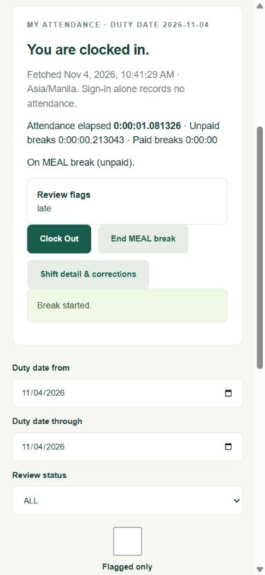
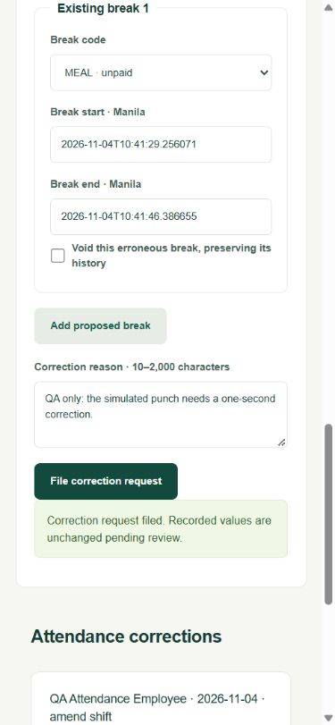
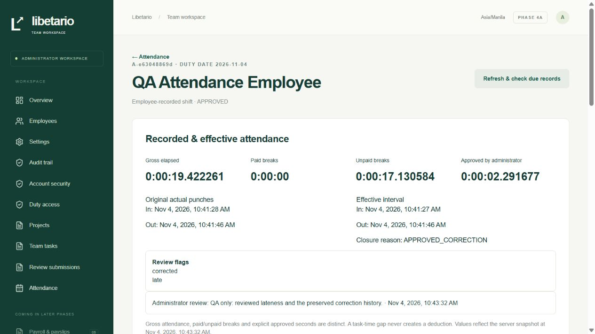

# Phase 4a delivery report

4 November 2026, Asia/Manila. **Attendance checkpoint passed. Awaiting owner acceptance before 4b.**

## Delivered

- Three new PostgreSQL tables, `attendance_shifts`, `attendance_breaks` and `attendance_adjustments`. The workspace has **30 application tables and 43 migrations**. Real composite foreign keys keep shifts with their employee and dated duty, and keep breaks and corrections with the correct shift. Partial unique indexes permit one open shift per employee and one open break per shift. GiST exclusions prevent overlapping effective shifts and breaks. Deferred checks enforce break containment and correction provenance.
- Employees with an active DUTY session can Clock In, start or end a break, Clock Out, view their own attendance and file corrections. Punches use the trusted server clock and the exact grant/version. Authentication creates no attendance. A valid grant can contain multiple adjacent shifts. Clock Out closes an open break at the same instant and appends an audit event with before/after values. Operation keys and canonical payload fingerprints protect duplicate clicks and retries.
- RLS and the restricted runtime role protect all three tables. Employee A cannot read B's shifts, breaks or adjustments in the app or through direct runtime SQL. Foreign and missing identifiers share the same 404 response for a valid actor. ACCOUNT alone cannot see attendance. Administrators require MFA and attendance writes use guarded database functions. The auth role has no table access.
- Versioned `WORK.attendance` controls the long-shift threshold, lateness grace, optional shift count cap, break codes and bounded reconciliation/bulk review. New shifts snapshot their grant, schedule and attendance policy. **MEAL is unpaid and SHORT is paid** by default. The schedule supplies the allowance unless the code specifies one. Actual elapsed time remains intact when an allowance is exceeded. Gross attendance, paid breaks and unpaid breaks appear separately with exact fractional seconds.
- Duty revocation, account disable and employment inactivation close open attendance and breaks in the same transaction, retaining recorded punches and flagging administrator review. Ordinary session expiry requires reauthentication and leaves a valid shift open. Explicit overnight carry retains the original duty date and honors the eight-hour ceiling. Grant expiry closes at the saved `valid_until`, including after downtime. More than 16 hours flags a shift without clipping it. Due records reconcile on startup, authorized refresh, eligible employee actions or the bounded operator command.
- AMEND_SHIFT and ADD_MISSING_SHIFT requests preserve original actual punches, the filed proposal and an immutable administrator decision. Approval and rejection require recent MFA and a reason. A missing shift needs a real grant and retains NULL actuals for punches that were never recorded. Stale, overlapping or out-of-window proposals cannot overwrite effective time. Applied corrections retain before/after audit and clear prior attendance approval.
- The administrator attendance view has date, employee, review status and flag filters. Shift review labels **SUGGESTED** as effective elapsed minus actual unpaid breaks. An administrator explicitly accepts the suggestion or overrides it within zero through effective gross seconds. Overrides require a reason. Flagged approvals also require an acknowledgement and reason. `approved_payable_seconds` stays NULL until review. A separate bulk preview shows the selected clean closed shifts and suggested seconds. Approval rechecks the exact versioned selection atomically and excludes flagged, open or disputed shifts.

The final write order is the existing policy lock, affected user rows in UUID order, session and duty, project/task/assignment parents where relevant, shifts, breaks, then adjustments. Profile edits use an administrator-only entry into that same employee lock order. Real PostgreSQL and HTTP tests covered double Clock In, revoke versus Clock In, Clock Out versus break start and correction versus punch. The ordered tests observed actual blocked database calls. Per-employee locking sufficed, so the checkpoint adds no global time coordination gate.

## Verification results

| Check                                                  | Result                                                                                                                                                                            |
| ------------------------------------------------------ | --------------------------------------------------------------------------------------------------------------------------------------------------------------------------------- |
| Unit, PostgreSQL integration and restricted-role suite | **111/111 passed**, exit 0                                                                                                                                                        |
| Actual Next HTTP suite                                 | **57/57 passed**, exit 0                                                                                                                                                          |
| Total                                                  | **168 passed, 0 failed, 0 skipped**. All 143 baseline cases retained, plus 12 attendance integration, 3 unit and 10 HTTP tests                                                    |
| Clean migration replay                                 | **43 migrations**, exactly **30 RLS-enabled application tables**, exit 0. Only the new disposable replay database was dropped                                                     |
| TypeScript, Prisma generation and operator due check   | Passed                                                                                                                                                                            |
| Production webpack build                               | Passed                                                                                                                                                                            |
| Production dependency audit                            | No known vulnerabilities reported                                                                                                                                                 |
| Local browser                                          | Employee at 390 px and administrator at desktop size. Real fake-fixture Clock In, MEAL start/end, Clock Out, correction request and two distinct administrator decisions verified |

The first regression exposed a missing execute grant in the profile lock integration. The fix grants a narrow administrator-only wrapper while keeping the internal work lock private. Older overnight assertions now scope their no-new-grant checks to their own employees because test histories are retained across runs. The final suite includes the same acceptance cases. Targeted follow-up assertions verified the stored clock-out and correction audit actor, reason and before/after values.

The blueprint's 15.6 is Clock Out with a running task and 15.7 is separate attendance/task totals. Both labels are corrected in [TEST_COVERAGE.md](TEST_COVERAGE.md). This checkpoint verifies the attendance portions. The running timer and combined totals cases remain 4b. The attendance part of 15.9 passed. Payroll recalculation and controlled financial adjustments remain Phase 5.

## Run locally

Keep the isolated local PostgreSQL running with `pnpm db:local`. In another PowerShell terminal run `pnpm db:migrate`, then `pnpm dev`. Use the established account, authenticator and duty setup in [README.md](../README.md). Employees open `/work/attendance` after duty sign-in. Administrators open `/admin/attendance` after MFA. Use **Account security → Verify recent MFA** before reviews if the last verification is over five minutes old.

README has the exact Windows commands for `pnpm test`, the test server and `pnpm test:http`. Use one Next server per folder and run the two suites sequentially. For a local operator due check use `pnpm attendance:reconcile`. Use `--test` for the dedicated test database. Preserve attendance, adjustments and audit rows in the consistent database/private-byte backup. Keep MFA keys backed up separately.

## Known gaps

- Checkpoint 4b covers task timers, disputed task segments, revision duration, the live work table, daily reports and CSV. Payroll, rounding and payslips remain Phase 5. Full Phase 4 exit is still pending the pause, rollover and multi-day totals tests in 4b.
- Reconciliation runs on demand and processes up to 100 due employees per pass by default. A due record may remain physically open until startup, refresh, an eligible action or the operator check. Read totals stop at the grant boundary while reconciliation is pending.
- The local browser walkthrough used responsive emulation and fake data. Wider device and assistive technology acceptance remains release work. Simultaneous sign-in forms can replace the shared anonymous CSRF cookie in the existing login flow. Reloading the sign-in form refreshes it. The existing PostgreSQL client queued-query deprecation warning remains non-failing.

## Owner/accountant decisions

Confirm MEAL/SHORT paid treatment and actual schedule allowances before Phase 5. Also confirm workdays, lateness grace, overnight use and whether multiple shifts should have a cap. Payroll classification, wage rounding, holidays, overtime and deductions remain owner/accountant decisions for Phase 5. Hosting stays local.

## Browser evidence

All records shown are fake test-database fixtures.

