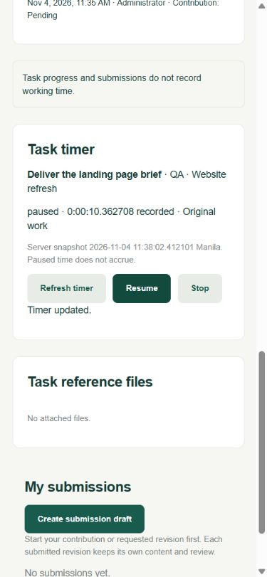
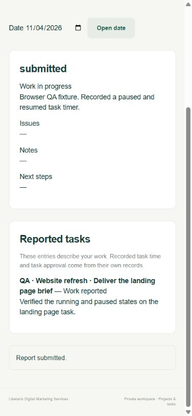
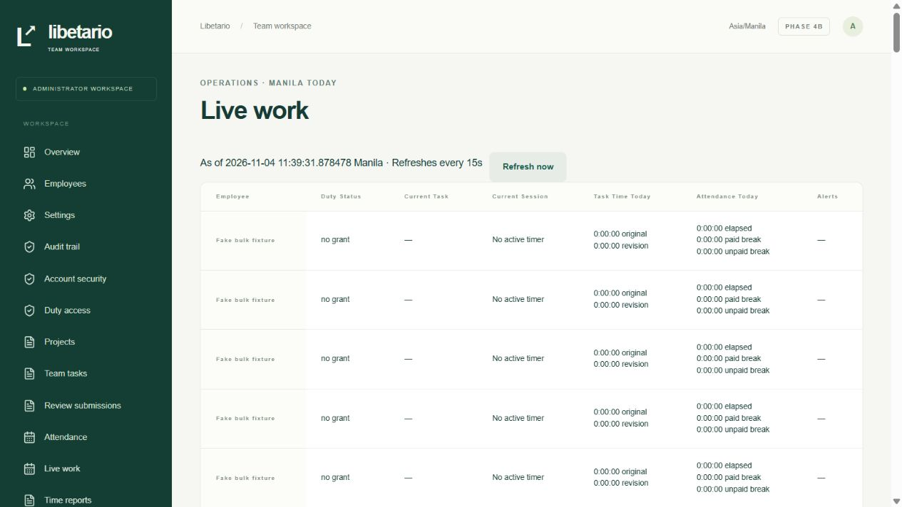

# Phase 4b delivery report

4 November 2026, Asia/Manila. **Time and attendance exit checks passed. Awaiting owner acceptance before Phase 5.**

## Delivered

- Four PostgreSQL tables for task time segments, segment adjustments, daily reports and report entries. The workspace now has **34 application tables and 49 migrations**. Each new table has RLS, restricted runtime grants and guarded mutations. Composite foreign keys bind work to the correct employee, assignment and shift. Partial unique indexes and a GiST exclusion allow one live logical timer, one running interval and no overlapping effective task intervals per employee.
- Employees with current DUTY access can Start, Pause, Resume, Stop and explicitly Switch on their own eligible assignments in ACTIVE projects. A timer requires an open shift and no open break. Start and Switch can move a PENDING contribution to IN_PROGRESS. Per-action operation keys and canonical payload fingerprints make retries safe. Server timestamps and exact fractional seconds are used throughout. Pause intervals accrue no task time. Revision time is tagged by the server and linked to the specific revision-required review.
- Clock Out stops running and paused timers at the same instant it closes attendance and any open break. Starting a break pauses a running timer. Ending the break leaves it paused. Duty revocation, grant expiry, account disable and inactive employment stop the timer with the system attendance closure. Assignment withdrawal, task cancellation, submission, approval and a project leaving ACTIVE stop affected timers with a recorded reason. Submission and timer stop commit together. Restoring access leaves timers stopped.
- Administrators can correct disputed, closed segments after recent MFA. A correction requires a stopped timer, closed shift, expected versions and a 10–2,000 character reason. Original and effective values remain available. Reviewed shift and segment changes can commit together. Overlaps, break intersections and segments outside the revised shift cause the transaction to fail.
- Employees can draft and submit one daily report per Manila calendar date, with entries for their own assignments. Submitted reports are frozen. Entries describe work separately from the timer ledger and task approval. Administrators can read submitted reports in the daily report view.
- The administrator live table shows the employee, duty status, current task, current session, task time today, attendance today and alerts with a server snapshot. The default 15-second poll leaves session idle expiry intact. Daily and weekly reports provide filters and original/revision breakdowns. The attendance comparison shows an 8-hour attendance day and 6 hours of task time as a 2-hour review gap. The gap has no effect on attendance approval or pay.
- CSV shares the report filters, quotes text and escapes spreadsheet formulas. It rejects ranges beyond 31 days and exports above 50,000 rows before streaming. The stream rechecks authorization between chunks and stops on revocation. Attendance approval remains a separate, explicit 4a decision. Phase 4 totals apply no rounding, paid-day or money calculation.

The write order is policy, affected user rows in UUID order, session and duty, project/task/assignment, shift, breaks, timers and adjustments. Project-level mutations recheck the affected timer roster under the parent lock and ask for a retry if it changed. Tests observed blocked PostgreSQL requests in both Start/revoke orders and in the project hold race. The existing per-employee ordering was sufficient for the tested races.

## Verification results

| Check | Result |
| --- | --- |
| Unit, PostgreSQL integration and restricted-role suite | **134/134 passed**, exit 0 |
| Actual Next HTTP suite | **64/64 passed**, exit 0 |
| Total | **198 passed, 0 failed, 0 skipped**. All 168 baseline cases retained, plus 21 integration, 2 unit and 7 HTTP tests |
| Clean migration replay | **49 migrations and exactly 34 RLS-enabled application tables**, exit 0. Replay used a disposable local database |
| TypeScript and Prisma generation | Passed |
| Production webpack build | Passed |
| Production dependency audit | No known vulnerabilities reported |
| Local browser | At mobile width a fake employee started, paused, resumed and stopped a timer, submitted a frozen daily report, downloaded a CSV and closed the shift. At desktop width an MFA administrator opened the live work table |

Blueprint 15.4–15.7 passed for timer histories, shared-task counting, pause/switch/return, Clock Out and the attendance/task comparison. Scenario 15.9 passed for attendance and segment corrections. Scenario 15.12 passed for overnight grant attribution and exact Manila day, week and year splits, including both running and paused timers. Payroll-specific checks stay deferred. [Acceptance coverage](TEST_COVERAGE.md)

## Run locally

Keep the isolated PostgreSQL running with `pnpm db:local`. In a separate PowerShell terminal run `pnpm db:migrate`, then `pnpm dev`. After duty sign-in, employees open **Attendance**, then **My tasks** or **Task time**. **Daily report** and **Time reports** are in the same navigation. Administrators sign in with MFA and use **Live work**, **Time reports** and **Daily reports**. Use **Account security → Verify recent MFA** before a segment correction when the last verification is over five minutes old.

The README has the exact Windows commands for `pnpm test`, the isolated test server and `pnpm test:http`. Run the two suites sequentially and use one Next server per folder. Continue to back up private upload bytes with the database and keep MFA keys separately. [README](../README.md)

## Known gaps

- Monthly presets, PDF reports, notifications and reopening submitted daily reports are deferred. Wider device and assistive-technology acceptance remains release work.
- The export tests validate the 50,000-row policy bound and exercise rejection above a smaller configured limit. They do not run a 50,001-row load test. Stream revocation stops subsequent chunks. Bytes already delivered remain with the recipient.
- Grant expiry reads stop accrual at the saved boundary. Materializing the corresponding closure still depends on startup, an eligible action, an authorized refresh or the bounded operator reconciliation. The existing PostgreSQL queued-query deprecation warning remains non-failing.
- The browser walkthrough encountered the existing shared anonymous CSRF cookie behavior when opening sign-in in multiple tabs. Reloading the sign-in form let the walkthrough proceed.

## Owner/accountant decisions

Confirm MEAL and SHORT treatment, actual break allowances, workdays, lateness grace and overnight use before Phase 5. Confirm which attendance basis, rounding, holidays, overtime, deductions and partial-day treatment to use for payroll. Reports default to Monday-start weeks and a 15-second live refresh through the versioned WORK policy. Hosting stays local. [Policy defaults](ASSUMPTIONS.md)

## Browser evidence

All records shown are fake test-database fixtures.

