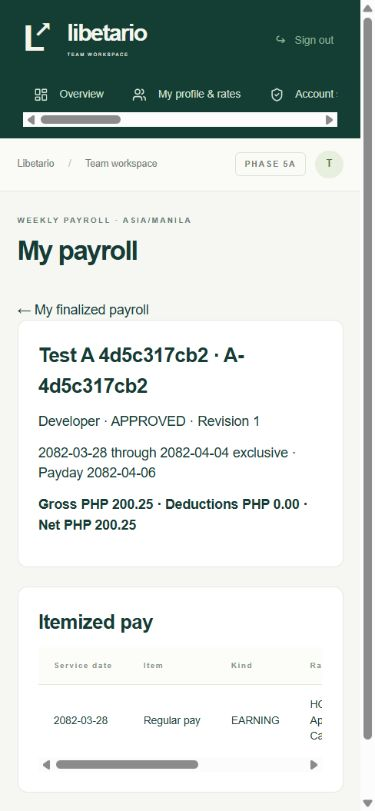

# Phase 5a delivery report

4 November 2026, Asia/Manila. **Checkpoint 5a passed. Awaiting owner acceptance before 5b.**

## Delivered

- Seven payroll tables bring the workspace to **41 application tables and 54 migrations**. Every new table has RLS. The restricted runtime uses guarded functions for writes and redacted projections for reads. PostgreSQL prevents overlapping canonical weeks, duplicate drafts and multiple current obligations for one employee and period.
- The administrator readiness screen lists each missing PAY decision. Legacy weekday and rounding values do not count as configuration. An administrator with recent MFA can publish an effective-dated revision with a reason. The first period fixes the chosen cutoff weekday. A week uses start-inclusive and end-exclusive Manila dates.
- Drafts use administrator-approved attendance, effective rates and policy, exact microseconds and integer quotient and remainder for explicit rounding. They itemize days or hours, earnings, deductions and net. Each attendance item identifies the exact shift, version, authorized duty date, allocation and review evidence. Missing punches, open or unapproved shifts, pending corrections, unresolved flags and negative net block approval. Reviewed overrides and midnight allocations must sum to the approved seconds.
- Premiums, allowances and bonuses take reviewed manual amounts. The review shows WORK holiday context. Deductions support fixed or reviewed manual amounts with explicit employee or designation applicability. A fixed deduction applies once per week using the revision effective on the last included date. Manual entries require recent MFA, reason and evidence, and preserve the before and after values. The seed supplies an empty PAY configuration and no statutory entries.
- Approval rechecks the reviewed manifest and source versions after the cutoff and stores the frozen snapshot and digest. Post-approval attendance changes flag the original line for review. An approved unpaid line can be voided or replaced with an audited decision. Approving a replacement marks the original ADJUSTED and retains its amounts and snapshot. Employees can view their own finalized lines using ordinary account sign-in, including off duty.

The existing policy and sorted employee lock order continues through duty, shifts, breaks and attendance corrections before locking periods and lines. Approval and attendance corrections serialize on the employee lock. Payroll calculations never read task duration.

## Verification results

| Check | Result |
| --- | --- |
| Full Windows regression, first pass | **146/146 unit and PostgreSQL tests and 66/66 real HTTP tests passed** |
| Full Windows regression, second consecutive pass | **146/146 unit and PostgreSQL tests and 66/66 real HTTP tests passed** |
| Test inventory per pass | **212 passed, 0 failed, 0 skipped**. All 198 baseline cases and 14 new payroll cases |
| Clean migration replay | **54 migrations and exactly 41 RLS-enabled application tables**, exit 0 |
| TypeScript, Prisma generation and production webpack build | Passed |
| Production dependency audit | No known vulnerabilities reported |
| Intentional interruption | Verified an active trusted-clock override in a disposable database, terminated the runner, and observed both PostgreSQL listeners and the Next listener close |
| Local browser | A fake employee signed in off duty and viewed their approved line at a 390 px viewport. Administrator readiness and review pages were verified over real HTTP. |

The two full runs used fresh clusters, ports, keyrings and private roots after the interrupted run. Each closed its three listeners and removed its temporary checkout. The runner now owns the installed PostgreSQL processes directly and stops the unit cluster before HTTP begins. The forced interruption was tested while the trusted clock was overridden. The interrupted checkout was removed separately after its listeners closed.

The payroll checks covered scenarios 15.8, 15.9 before payment, 15.11 through approval, and the payroll cutoff and overnight portions of 15.12. Scenario 15.10 has finalized-line privacy evidence. The PDF download portion is scheduled for 5b. [Acceptance coverage](TEST_COVERAGE.md)

## Run locally

With the dedicated local PostgreSQL running, apply the migrations with `pnpm db:migrate`, regenerate Prisma with `pnpm db:generate`, and run `pnpm dev`. Open **Payroll → Payroll settings and readiness** as an MFA administrator. The employee view is **My payroll**. See the [README](../README.md) for setup, the full `pnpm test:all:win` command and the existing separate Windows test commands.

## Known gaps

- Payment recording, the paid correction workflow with a real ledger, protected payslip PDFs and exports are 5b scope. Checkpoint 5a stops at approval.
- Each canonical period has an explicit roster of up to 100 employees. Review the roster before creating the period. Configure employee schedules and resolve missing-punch cases through Attendance before payroll approval.
- Payroll supports reviewed manual premiums and fixed or reviewed manual deductions. Confirm the treatment that applies to the business before preparing live payroll.
- The payroll API and full-page responses return HTTP 404 for missing and foreign finalized lines. Once React Flight is streaming, Next can deliver the same 404 result inside a response with HTTP status 200. The employee receives the same not-found view for either case.
- The item table scrolls horizontally on narrow screens. The manual browser walkthrough covered the employee view. Administrator readiness and review were exercised through HTTP and rendered page tests.

## Owner/accountant decisions

Confirm pay basis, approved attendance and break treatment, paid-day and partial-day rules, minimum pay, lateness, time and money rounding, manual earnings, deduction applicability, cutoff and payday, and payment methods. Confirm how a correction to a paid line may be applied as a reviewed manual item in a later period. The application stores the original paid line as the correction reference. [Payroll assumptions](ASSUMPTIONS.md)

## Browser evidence

The screenshot shows a fake employee and a synthetic pay period in a disposable database.

